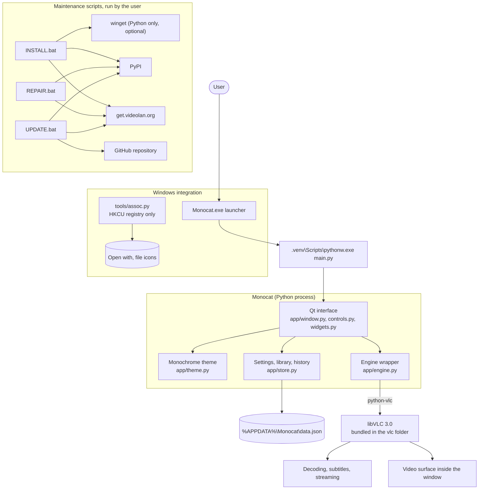

<p align="center">
  
</p>

<h1 align="center">Monocat</h1>
<p align="center"><i>Less interface. More video.</i></p>

<p align="center">
  
  
  
  
  
  
</p>

<p align="center">
  A minimal, monochrome media player for Windows with its own built-in VLC engine.
  The video fills the window, two thin bars appear only at the top and bottom
  edges, and everything else lives in a single menu. It plays everything VLC
  plays, needs no separate VLC install, and installs, repairs and updates
  itself with one batch file each.
</p>

---

## Download

Go to the [Releases page](https://github.com/arcticfoxcreations/Monocat/releases/latest) and pick one file under Assets:

- **Monocat-Setup-x.y.z.exe** is the installer. Most people want this one.
- **Monocat-Portable-x.y.z.zip** is a folder you can move or edit. Extract it, then run `INSTALL.bat`.

Do not use the green Code button, Download ZIP: that is raw source without the installer or the VLC engine.
Windows may warn about an unknown publisher. See [Windows SmartScreen](#windows-smartscreen).

---

## Table of contents

- [Download](#download)
- [Why Monocat](#why-monocat)
- [Features](#features)
- [Tech stack](#tech-stack)
- [Architecture](#architecture)
- [Requirements](#requirements)
- [Download options](#download-options)
- [Installation](#installation)
- [Repair and updates](#repair-and-updates)
- [Bundled VLC engine](#bundled-vlc-engine)
- [Uninstallation](#uninstallation)
- [Using Monocat](#using-monocat)
- [Project structure](#project-structure)
- [Customisation](#customisation)
- [Rebuilding the launcher](#rebuilding-the-launcher)
- [Building a release](#building-a-release)
- [Windows SmartScreen](#windows-smartscreen)
- [Troubleshooting](#troubleshooting)
- [What works and what does not](#what-works-and-what-does-not)
- [Security and privacy](#security-and-privacy)
- [Roadmap](#roadmap)
- [Credits and licence](#credits-and-licence)

## Why Monocat

Most players put every control on screen at once. Monocat starts from the
opposite end: black and white only, no accent colours, five controls on the
bottom bar, one button on the top bar. Move the cursor to the middle of the
video and both bars disappear. Move it to an edge and only that edge's bar
comes back.

Monocat is a modified fork of [Pylon](https://github.com/nirmaljosephukken/pylon-player)
by Nirmal Joseph Ukken (MIT licence). VLC does all playback and decoding.
Monocat is not affiliated with VideoLAN or the VLC project.

## Features

| Area | What it does |
| --- | --- |
| **Interface** | Dark grey or pitch black, white controls, no accent colours, neon themes or tints |
| **Bottom bar** | Compact: thin seek line, play/pause, volume, time, repeat, subtitles, settings, fullscreen. Previous, next, audio track and queue can be added |
| **Bars preferences** | Preferences, Bars: bar size (70 to 140 percent), bottom bar opacity, and a switch for every control on the bar |
| **Repeat** | Nothing loops by default. A small repeat button cycles off, this file, whole queue |
| **Update check** | Help, Check for updates looks at Monocat's repository and the VLC engine on request. A small "Update available" chip appears on the home screen when something is newer |
| **Volume** | Expands from a single speaker button when the cursor is over it, mouse wheel supported |
| **Top bar** | One three-dot button that opens Media, Playback, Audio, Subtitles, Video, Tools, Preferences and Help |
| **Edge-triggered bars** | Each bar shows only while the cursor is near its own edge; the middle of the video hides both |
| **Library and queue** | Folders, playlists, bookmarks, per-folder presets and resume where you stopped (inherited from Pylon) |
| **Playback** | Anything VLC plays, because VLC does the decoding |
| **Windows integration** | Listed under "Open with" and Default apps, optional replacement icon for chosen file types |
| **Home screen** | Animated cat logo that runs only while the home screen is visible |
| **No VLC install** | Monocat keeps its own copy of the VLC engine in the `vlc` folder; you never install the VLC program |
| **Install, repair, update** | Each script scans first, lists what it will do, asks one question and then does it all. Old files and old VLC engines are removed on update |
| **Two downloads** | A portable zip (scripts, folder install) or a Windows Setup `.exe` that contains everything |

## Tech stack

- **Language:** Python 3.10 or newer, 64-bit
- **Interface:** PySide6 (Qt for Python)
- **Playback engine:** VLC 3.0 through the python-vlc bindings (libVLC)
- **Launcher:** a small native `Monocat.exe` written in C, built with MinGW-w64
- **Windows integration:** standard-library Python writing to the current user's registry (HKCU) only
- **Packaging:** none; the app runs from its own folder with a private `.venv`

## Architecture

Monocat is a desktop interface. It does not decode media itself. Everything
below runs on the user's machine; the only network access is what the user
starts from the install, repair and update scripts.



**Layers, top to bottom:**

| Layer | Responsibility |
| --- | --- |
| **Launcher** (`Monocat.exe`) | Lets Windows list Monocat by name and icon, then starts `main.py` with the private Python environment |
| **Qt interface** (`app/window.py`, `controls.py`, `widgets.py`) | The main window, the two overlay bars, menus and dialogs. The bars are separate translucent windows over the video, and a 50 ms timer compares the cursor with the window edges |
| **Theme** (`app/theme.py`) | The grey palette and the global stylesheet. Text and icons stay light on every theme |
| **Engine wrapper** (`app/engine.py`) | The only code that talks to libVLC. Finds VLC, opens media, handles tracks, volume and seeking |
| **Store** (`app/store.py`) | Settings, library, bookmarks and history in one JSON file in `%APPDATA%\Monocat` |
| **Windows integration** (`tools/assoc.py`) | Registers "Open with" and swaps file icons, saving every original value first so it can be restored exactly |
| **Maintenance scripts** | `INSTALL.bat`, `REPAIR.bat`, `UPDATE.bat`, `UNINSTALL.bat`, `tools/get_vlc.py` and `tools/update.py`. They scan first, list what they will do and ask once |

**Why a separate launcher and a private environment:** Windows matches "Open
with" entries to an executable name, so Monocat ships a tiny `Monocat.exe`
instead of pointing at `pythonw.exe`. The `.venv` folder keeps Monocat's
packages out of the user's own Python, so nothing else on the machine can
be affected.

## Requirements

| Requirement | Version | Source | Installed by INSTALL.bat |
| --- | --- | --- | --- |
| Windows | 10 or 11, 64-bit | not applicable | not applicable |
| Python | 3.10 or newer, 64-bit | python.org | Only if missing, after asking, through winget. It stays installed, because Monocat runs on it |
| PySide6-Essentials | 6.6 or newer | PyPI | Yes, into the local `.venv` folder |
| python-vlc | 3.0.20123 up to, not including, 4 | PyPI | Yes, into the local `.venv` folder |
| VLC engine (libVLC) | 3.0.x, 64-bit | get.videolan.org | Yes, after asking: only the engine files, unpacked into the local `vlc` folder. The VLC program is not installed |
| winget | any | Microsoft (included in current Windows 10 and 11) | Used only for the optional Python install above |

You do not need to install VLC. Monocat uses the engine in its own `vlc` folder. If that folder is
missing and VLC is already installed on the PC, Monocat can use that copy instead. Python is always
taken from your system.

## Download options

Each release offers two downloads. Pick one.

| Download | For whom | What you get |
| --- | --- | --- |
| **Monocat-Setup-x.y.z.exe** | Most people. One file | A normal Windows installer. Python, the interface libraries and the VLC engine are inside, so nothing else is downloaded or installed. Installs for your user only (no administrator rights), adds a Start menu entry, an optional Desktop shortcut and an optional "Open with" entry. Uninstall from Windows Settings, Apps |
| **Monocat-Portable-x.y.z.zip** | People who want a folder they can move, inspect or edit | The source and the `.bat` scripts. `INSTALL.bat` sets everything up inside the folder, `UPDATE.bat` updates it |

The Setup build does not replace the `.mkv` and `.mov` icons. That feature belongs to the portable folder
(`tools/assoc.py`), which can restore the original icons exactly. Both builds use the same program code.

## Installation (portable zip)

1. Download the portable zip and extract it to a folder you want to keep, for example `C:\Apps\Monocat`.
   Do not run the scripts from inside the zip.
2. Double-click `INSTALL.bat`.
3. It first **scans** and prints one line per item, marked ok or missing: the private environment, Python
   (only when the environment must be created), the packages, the VLC engine, the shortcuts and the Open with entry.
   Nothing is changed during the scan.
4. It then lists everything missing, with the source of each item, and asks **one** question. Answer Y and it
   installs all of it in one run, then runs a final check:
   - Python 3.12 through winget, only if no suitable Python exists (user scope, no administrator rights);
   - a private `.venv` environment and the two packages from `requirements.txt`;
   - Monocat's own VLC engine in the `vlc` folder, downloaded from videolan.org and checked against VideoLAN's
     SHA-256 file (skipped if a working VLC is already on the PC);
   - Desktop and Start menu shortcuts;
   - the "Open with" entry and the cat icon for `.mkv` and `.mov`.
5. Start Monocat from the shortcut.

If everything is already in place, the script says so and exits. A Python or VLC you already had is never touched
or removed. If the script installs Python itself it writes `.installed-python`, so `UNINSTALL.bat` can offer to
remove only that copy. If Windows has not yet picked up a freshly installed Python, the script tells you to run it
once more and continues from where it stopped. Your default player is not changed. To make Monocat the default,
use Windows Settings, Apps, Default apps.

## Repair and updates

**Repair.** Run `REPAIR.bat` if Monocat stops starting, a package is damaged, Python was updated or removed, the VLC
engine is missing or will not load, or the shortcuts or "Open with" entry vanished. It runs the same scan as
`INSTALL.bat` in repair mode: scan, list the problems, one question, fix everything. Damaged packages are
reinstalled and a damaged VLC engine is downloaded again. Only the `.venv` folder is ever deleted for a rebuild.

**Update.** Run `UPDATE.bat`. It asks you to close Monocat if it is running, then checks without changing anything:

1. the VLC engine, against the newest VLC 3.x on videolan.org;
2. Monocat's program files, against the version in the repository set as `UPDATE_REPO` in `app/__init__.py`;
3. the Python packages, with a pip dry run.

It lists what is newer and asks **one** question. On yes it updates everything that was listed:

- the new VLC engine is verified with SHA-256 and swapped in, then the **old engine is deleted** so versions do not pile up;
- Monocat's files are backed up to `backup_before_update` (only the newest backup is kept), replaced, and **files the
  new version no longer has are removed**;
- newer `.bat` files are saved as `NAME.bat.new` and swapped in as soon as the update window closes;
- your settings, library, `.venv` and the original file-icon backup are never touched.

**From inside Monocat.** Menu (three dots), Help, Check for updates shows the installed and latest version of
Monocat and the VLC engine. If something is newer, **Update now** closes Monocat and opens `UPDATE.bat`. With the
Setup build the button opens the releases page instead. When a check has found something, the home screen shows a
small **Update available** chip at the bottom, and the Help entry changes to "Update available...". The chip
follows the last check. It disappears by itself once you are up to date.

Maintainers: `UPDATE_REPO` in `app/__init__.py` is set to `arcticfoxcreations/Monocat`; change it if you fork the project. If it is ever empty the repository
check reports that no update source is set, and the VLC engine and package checks still work.

## Bundled VLC engine

Monocat carries its own VLC engine so users never install the VLC program. It lives in the `vlc` folder
next to `main.py` and holds `libvlc.dll`, `libvlccore.dll`, `plugins\` and VLC's licence files. Monocat
looks there first and falls back to an installed VLC only if the folder is missing.

`INSTALL.bat`, `REPAIR.bat` and `UPDATE.bat` fill the folder by running `tools/get_vlc.py`. You can also run it
yourself:

```
python tools\get_vlc.py                 default version set in the script
python tools\get_vlc.py latest          newest VLC 3.x on videolan.org
python tools\get_vlc.py 3.0.21          an exact version
python tools\get_vlc.py --zip <file>    a VLC win64 zip you downloaded yourself
```

It downloads only from `get.videolan.org`, checks the SHA-256 file before unpacking anything, and copies only
the engine files, never `vlc.exe`.

The `vlc` folder is in `.gitignore` because it is large (roughly 100 to 150 MB), so the repository stays small and
the engine is fetched on the user's PC. If you want an offline release, run the script once and attach the whole
folder, `vlc` included, to a GitHub Release. When you ship it:

- keep VLC's `COPYING.txt` in the folder (libVLC is LGPL 2.1 or later; some plugins are GPL);
- state the bundled VLC version and link to that version's source at https://code.videolan.org/videolan/vlc;
- do not use VideoLAN's name or the cone logo to suggest endorsement;
- tell users to run `UPDATE.bat` for VLC security fixes, because a bundled copy does not update itself.

## Uninstallation

**Setup build:** Windows Settings, Apps, Installed apps, Monocat, Uninstall.

**Portable folder:** run `UNINSTALL.bat`. After one confirmation it restores the original file icons from
`assoc_backup.json` and removes the shortcuts and the "Open with" entry. It then asks, separately and with No as the
default, whether to delete your settings in `%APPDATA%\Monocat`, and, only if `INSTALL.bat` had installed Python for you,
whether to remove that copy. A Python you installed yourself is never removed. Then delete the folder, which also
removes the bundled VLC engine in `vlc`.

## Using Monocat

| Action | How |
| --- | --- |
| Show the bottom bar | Move the cursor to the bottom edge of the video |
| Show the menu button | Move the cursor to the top edge of the video |
| Hide both bars | Move the cursor to the middle of the video |
| Play or pause | Space, or the play button |
| Seek | Click or drag the thin line above the buttons |
| Volume | Hover the speaker button, or use the mouse wheel over it |
| Fullscreen | F, or the fullscreen button |
| All shortcuts | F1 |

The three-dot menu holds everything else: open file, folder or stream,
recent files, library, queue, stop, previous, next, jumps, speed, repeat,
sleep timer, audio and subtitle tracks, aspect ratio, snapshot, bookmarks,
picture in picture, Preferences and Help.

## Project structure

```
Monocat/
  INSTALL.bat          one-click setup with dependency checks
  REPAIR.bat           the same scan as INSTALL.bat in repair mode
  UPDATE.bat           scan, one question, then update the VLC engine, Monocat's files and the packages
  UNINSTALL.bat        undo shortcuts, Open with entry and icon change
  run-debug.bat        start with a console to read errors
  Monocat.exe          launcher (built from launcher/monocat.c)
  main.py              entry point
  requirements.txt     Python packages
  app/
    window.py          main window, menus, auto-hide logic
    controls.py        top bar, bottom bar, volume control
    widgets.py         seek line, overlay windows, animated logo, toast
    theme.py           monochrome palette and stylesheet
    engine.py          libVLC wrapper
    store.py           settings and library storage
    library.py, sidebar.py, home.py, music.py, thumbs.py, dialogs.py, icons.py, util.py
  assets/
    monocat.ico        application and file icon
    monocat.png        still logo
    logo/              animation frames for the home screen logo
  tools/
    assoc.py           registry integration with backup and restore
    shortcuts.ps1      creates the Desktop and Start menu shortcuts
    update.py          updates program files from the GitHub repository, removes files that no longer exist
    get_vlc.py         downloads and verifies the VLC engine, replaces the old one
    doctor.py          read-only health check used by the scripts
    running.ps1        tells UPDATE.bat whether Monocat is still running
  installer/
    monocat.spec       PyInstaller recipe for the Setup build
    monocat.iss        Inno Setup script for Monocat-Setup.exe
  .github/workflows/
    release.yml        builds the portable zip and the Setup when a version tag is pushed
  vlc/                 bundled VLC engine (created by the scripts, not in the repository)
  launcher/
    monocat.c, monocat.rc   source of Monocat.exe
```

## Customisation

- File icon: replace `assets/monocat.ico`, then run `INSTALL.bat` again.
- File types that get the icon: edit `EXTS` at the top of `tools/assoc.py`, for example add `".mp4"`.
- Bar size, bar opacity and which controls show: Preferences, Bars (stored in the settings file, defaults in `app/store.py`).
- Bar layout and the narrowest window width for each control: `app/controls.py`.
- Greys: `app/theme.py`.
- Seek line: `SeekBar.paintEvent` in `app/widgets.py`.
- Logo animation: the frames in `assets/logo`.

To use your own artwork, replace `assets/monocat.png`, `assets/monocat.ico`
and the files in `assets/logo`, then run `INSTALL.bat` again.

## Rebuilding the launcher

The repository includes a built `Monocat.exe`. To rebuild it yourself with MinGW-w64:

```
cd launcher
x86_64-w64-mingw32-windres monocat.rc -O coff -o monocat_res.o
x86_64-w64-mingw32-gcc -O2 -municode -mwindows -s -o ../Monocat.exe monocat.c monocat_res.o
```

Windows SmartScreen may warn about the launcher because it is not
code-signed. You can read `launcher/monocat.c`, which is about 50 lines, or
rebuild it as shown above.

## Building a release

Maintainers only. Set `UPDATE_REPO` in `app/__init__.py` and the project URL in `installer/monocat.iss`, commit, then tag:

```
git tag v1.0.0
git push origin v1.0.0
```

The workflow `.github/workflows/release.yml` builds on a Windows runner: the portable zip, the VLC engine
(downloaded and SHA-256 checked), `Monocat.exe` with PyInstaller, and `Monocat-Setup-1.0.0.exe` with Inno Setup. It attaches both
files and a `SHA256SUMS.txt` to the GitHub Release. To build by hand on Windows: `python tools\get_vlc.py --yes`,
`pip install -r requirements.txt pyinstaller`, `pyinstaller --noconfirm installer\monocat.spec`, then
`ISCC /DAppVersion=1.0.0 installer\monocat.iss`. Keep the version in `app/__init__.py` and the tag in step.
The Setup contains VLC, so ship VLC's `COPYING.txt` (it is inside the bundled `vlc` folder), state the bundled VLC
version in the release notes and link https://code.videolan.org/videolan/vlc.

## Windows SmartScreen

Windows may show "Windows protected your PC, Unknown publisher" for `Monocat.exe` and for the Setup. This
happens to every program that is not digitally signed and does not yet have download reputation. It is not a verdict
that the file is harmful, and the MIT licence has no effect on it: only a code-signing certificate changes the
publisher shown. To run the file anyway, click **More info**, then **Run anyway**. The source is public and the
release lists SHA-256 checksums, so you can verify what you downloaded.

Maintainers can reduce the warning by signing releases (a certificate from a certificate authority, a signing
service such as Azure Trusted Signing, or a free open-source signing programme if the project qualifies),
and can submit false-positive reports for new builds to Microsoft Defender. Reputation also builds up as more
people download the same signed file.

## Troubleshooting

| Problem | What to do |
| --- | --- |
| Monocat does not start | Run `run-debug.bat` and read the message. Errors are also written to `logs\error.log` |
| "VLC not found" | Run `REPAIR.bat`. It downloads the VLC engine into the `vlc` folder again. It needs an internet connection |
| Python was updated or removed and Monocat no longer starts | Run `REPAIR.bat`. It rebuilds `.venv` |
| Monocat is missing from "Open with" | Run `REPAIR.bat`. Keep the folder in a fixed place, because the entries point to `Monocat.exe` there |
| Files still show the old icon | Restart Explorer, or sign out and in once. Windows caches icons |
| Moved the folder | Run `INSTALL.bat` again from the new location. The scan notices the old shortcuts and Open with entry point elsewhere |
| Windows says "Unknown publisher" | See Windows SmartScreen above. Click More info, then Run anyway |
| The Update available chip never appears | It shows only after a check. Use Help, Check for updates once, or tick the start-up check in Preferences, Privacy |

## What works and what does not

| Status | Item |
| --- | --- |
| Available | Playback of everything VLC plays, library, queue, bookmarks, presets, subtitles, audio tracks, snapshots, picture in picture |
| Available | One-click install, repair, uninstall with exact restore of original file icons |
| Experimental | Recording (Tools menu). libVLC 3 cannot start recording during playback, so Monocat restarts the stream and copies it to `Videos\Monocat` |
| Not included | Linux and macOS. Pylon supports them, but this fork is not adapted or tested for them |
| Not included | VLC 4. Monocat is written for VLC 3.0 |
| Not included | Features that Pylon does not have yet. See the Pylon README for its list |
| Not verified | The scripts, launcher, registry tool, Setup build and release workflow were written and checked statically and with mocks on Linux. They have not yet been run on a real Windows PC or on GitHub's runners. Reports are welcome |

## Security and privacy

- No telemetry. By default the app never goes online by itself. Network access happens only when you run a `.bat` file, open a stream or playlist URL, choose the subtitle search, or click Help, Check for updates. That check reads one file from github.com and the file list on get.videolan.org, and sends nothing about you or your computer (your IP address is visible to those two sites, as with any web request). A start-up check exists but is off until you tick it in Preferences, Privacy.
- Nothing needs administrator rights. All registry changes are under the current user (HKCU).
- Every registry value that is overwritten is saved to `assoc_backup.json` first, and `UNINSTALL.bat` restores it exactly.
- Python is installed only after a clear prompt that names the package and publisher, and only through winget. A Python that was already on the machine is never removed.
- The VLC engine is downloaded only from get.videolan.org, only after a prompt, is verified against VideoLAN's SHA-256 file before unpacking, and stays inside the Monocat folder. Nothing is installed system-wide.
- Settings, library and history stay on your computer in `%APPDATA%\Monocat`.
- Updates run only when you start `UPDATE.bat` (or choose Update now in the app) and say yes. Program files come only from the repository you configure and are backed up first; packages come from PyPI.
- The launcher is about 50 lines of C and is included as source.

## Roadmap

Ideas, not promises:

- Bundle an embedded Python in the portable zip (the Setup build already has one)
- Code-signed Setup and launcher (see Windows SmartScreen)
- Support for VLC 4
- Linux and macOS builds
- More file types for the replacement icon, chosen in a settings page

## Credits and licence

- **Pylon** by Nirmal Joseph Ukken, MIT licence: https://github.com/nirmaljosephukken/pylon-player
- **Interface concept** by Juxtopposed, CC BY 4.0. Design values were adapted; no files from the design are included.
- **VLC and libVLC** by VideoLAN, LGPL 2.1 or later. VLC is a trademark of VideoLAN.
- **python-vlc**, LGPL 2.1 or later, and **PySide6 (Qt for Python)**, LGPL 3.
- **MinGW-w64** was used to build `Monocat.exe`.
- **Icon:** a pixel-art cat, stored in `assets`. Replace it with your own artwork if you prefer.

Monocat is released under the MIT licence. See `LICENSE`. Notices inherited
from Pylon are in `THIRD_PARTY_NOTICES.md`. Monocat is not affiliated with,
sponsored by or endorsed by VideoLAN.

---

<p align="center"><i>Less interface. More video.</i></p>
